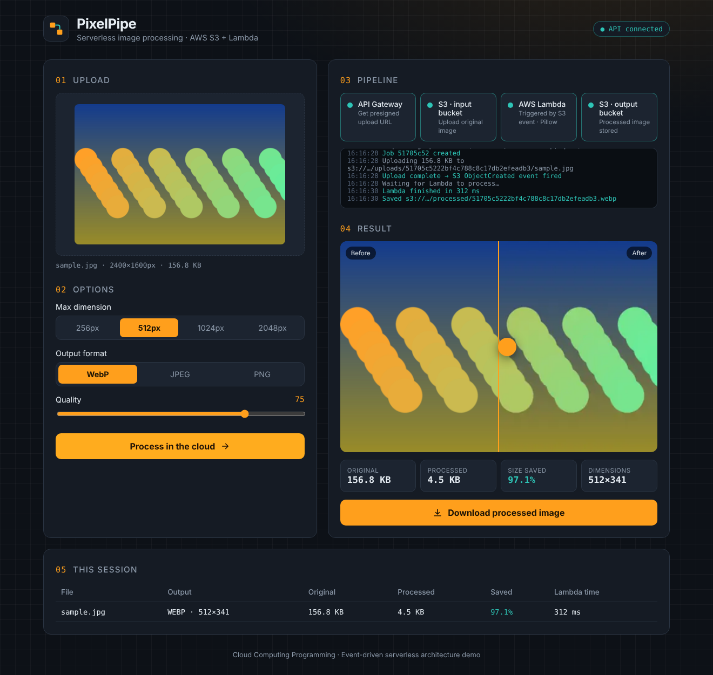

# CloudCrunch — Serverless Image Processing System (AWS Lambda + S3)

Upload an image in the browser → it lands in an **S3 input bucket** → S3 fires an
event → an **AWS Lambda** function resizes, compresses and converts it with
**Python + Pillow** → the result is stored in an **S3 output bucket** → the web app
shows a before/after comparison and a download button.

No servers to run. You pay only for the milliseconds Lambda actually runs.



---

## Architecture

```
 ┌──────────┐ 1. POST /upload-url ┌──────────────┐   ┌───────────────┐
 │ Browser  │ ──────────────────▶ │ API Gateway  │──▶│  API Lambda   │
 │ (HTML/JS)│ ◀── presigned POST ─│  (HTTP API)  │   │ (presign/stat)│
 └────┬─────┘                     └──────────────┘   └───────────────┘
      │ 2. upload file directly                              ▲
      ▼                                                      │ 5. GET /status/{id}
 ┌──────────────┐ 3. ObjectCreated ┌─────────────────────┐   │    (polls result JSON)
 │ S3 INPUT     │ ───── event ───▶ │ ImageProcessing     │   │
 │ uploads/...  │                  │ Lambda + Pillow     │   │
 └──────────────┘                  └─────────┬───────────┘   │
                                             │ 4. write      │
                                             ▼               │
                                   ┌─────────────────────┐   │
                                   │ S3 OUTPUT (no       │───┘
                                   │ trigger → no loop)  │
                                   │ processed/ results/ │
                                   └─────────────────────┘
                         CloudWatch: logs + error alarm for both Lambdas
```

| Component | File | Role |
|---|---|---|
| Processor Lambda | `processor/app.py` | Triggered by S3. Resize (aspect-ratio safe, never upscales), compress, convert to WebP/JPEG/PNG, fix phone EXIF rotation, write result + JSON stats |
| API Lambda | `api/app.py` | `POST /upload-url` (presigned POST, 10 MB + image-type limits enforced by S3), `GET /status/{jobId}`, `GET /health` |
| Pillow layer | `layer/pillow-layer.zip` | Pillow 12 pre-built for Lambda (Python 3.12, x86_64) — ready to use |
| Infrastructure | `template.yaml` | AWS SAM: 2 buckets, 2 Lambdas, layer, HTTP API, IAM (least privilege), log groups, CloudWatch alarm, lifecycle rules |
| Frontend | `frontend/` | Drag-and-drop upload, options, live pipeline view, before/after slider, stats, download, session history |
| Tests | `tests/test_pipeline.py` | 10 tests incl. full end-to-end flow on mocked S3 (no AWS needed) |

### Project structure
```
serverless-image-processing/
├── processor/app.py        # S3-triggered image processing Lambda
├── api/app.py              # upload-URL + status API Lambda
├── layer/pillow-layer.zip  # Pillow Lambda layer (pre-built)
├── frontend/               # index.html, styles.css, app.js, config.js
├── template.yaml           # whole AWS infrastructure (SAM)
├── scripts/                # deploy.py, teardown.py, build_layer.py
├── tests/                  # pytest suite (mocked AWS)
├── events/s3-put.json      # sample S3 event for console "Test"
├── REPORT.md               # one-page academic report
└── DEMO_SCRIPT.md          # 10-minute demo script
```

---

## Option A — Deploy in one command (recommended)

**Prerequisites** (one-time):
1. AWS account + a [budget alert](https://console.aws.amazon.com/billing/home#/budgets) (e.g. $1).
2. [AWS CLI](https://aws.amazon.com/cli/) → run `aws configure` with an IAM user's access key.
3. [AWS SAM CLI](https://docs.aws.amazon.com/serverless-application-model/latest/developerguide/install-sam-cli.html).
4. Python 3.9+.

```bash
python scripts/deploy.py --region ap-south-1     # Mumbai; any region works
```

The script deploys everything (~2 min) and writes your API URL into
`frontend/config.js`. Then just **open `frontend/index.html` in your browser** and
upload an image.

> Want a public link for the demo? Upload the 4 files in `frontend/` to any static
> host (S3 static website, GitHub Pages, Netlify). CORS is already configured.

**Clean up afterwards** (deletes buckets, Lambdas, API — nothing left billing):
```bash
python scripts/teardown.py --region ap-south-1
```

---

## Option B — Build it by hand in the AWS Console (good for learning / viva)

Use region **ap-south-1** (or any) consistently.

1. **S3** → Create two buckets, e.g. `img-input-<yourname>` and `img-output-<yourname>`
   (keep "Block all public access" ON).
2. **Lambda → Layers → Create layer**: name `pillow`, upload `layer/pillow-layer.zip`,
   runtime Python 3.12, architecture x86_64.
3. **Lambda → Create function** `ImageProcessingFunction`: Python 3.12, x86_64.
   - Paste `processor/app.py` into the code editor → **Deploy**.
   - Configuration → General: memory **1024 MB**, timeout **30 s**.
   - Configuration → Environment variables: `OUTPUT_BUCKET = img-output-<yourname>`.
   - Code → Layers → Add a layer → Custom → `pillow`.
   - Configuration → Permissions → click the role → *Add permissions → Create inline policy* (JSON):
     ```json
     {"Version":"2012-10-17","Statement":[
       {"Effect":"Allow","Action":"s3:GetObject","Resource":"arn:aws:s3:::img-input-<yourname>/*"},
       {"Effect":"Allow","Action":"s3:PutObject","Resource":"arn:aws:s3:::img-output-<yourname>/*"}]}
     ```
4. **Input bucket → Properties → Event notifications → Create**: prefix `uploads/`,
   event *All object create events*, destination *Lambda* → `ImageProcessingFunction`.
   ⚠️ Never add a trigger to the output bucket (infinite loop).
5. **Test without the frontend**: upload any photo to the input bucket into a folder
   `uploads/0123456789abcdef0123456789abcdef/`. Within a second, `processed/…webp`
   and `results/…json` appear in the output bucket. See the logs in **CloudWatch →
   Log groups → /aws/lambda/ImageProcessingFunction**.
6. **For the web app**, create a second function `UploadApiFunction` from
   `api/app.py` with env vars `INPUT_BUCKET`, `OUTPUT_BUCKET`, permissions
   `s3:PutObject` on input and `s3:GetObject` on output, then **API Gateway → HTTP API**
   with routes `POST /upload-url`, `GET /status/{jobId}`, `GET /health` → that Lambda,
   CORS: origin `*`, methods GET/POST, header `content-type`. Add a CORS rule to the
   input bucket allowing `POST` from `*`. Put the API's invoke URL in `frontend/config.js`.

(Option A does all of step 6 automatically — that's why it's recommended.)

---

## Run a free local demo (no AWS account needed)

`scripts/local_server.py` serves the real frontend and runs the real Pillow
logic from `processor/app.py`, swapping S3 + Lambda for a local Flask stub.
Good for clicking through the UI or presenting without paying for AWS.

```bash
python3 -m venv .venv && source .venv/bin/activate   # one-time
pip install -r requirements-dev.txt                   # one-time
python scripts/local_server.py                        # start
```
Open **http://127.0.0.1:5000** in your browser (use `127.0.0.1`, not
`localhost`, if your browser/network blocks the `localhost` hostname).

Stop it with `Ctrl+C` in that terminal, or from another terminal:
```bash
pkill -f "python scripts/local_server.py"
```

Output files land in `local_storage/` (gitignored). This mode is for demos
only — the pipeline-step animation is cosmetic since there's no real S3
event triggering a real Lambda; see **Option A** below to actually deploy it.

## Run the tests locally (no AWS account needed)

```bash
pip install -r requirements-dev.txt
pytest -v
```
Covers option validation, every format conversion (incl. transparent PNG → JPEG),
no-upscaling, the full API → S3 → Lambda → status flow, corrupt-file handling and
API input validation.

## Processing options

| Option | Values | Notes |
|---|---|---|
| Max dimension | 256 / 512 / 1024 / 2048 px | Longest side; aspect ratio kept; small images aren't enlarged |
| Format | WebP / JPEG / PNG | Transparency flattened to white for JPEG |
| Quality | 10–95 | Applies to WebP and JPEG (PNG is lossless) |

Options travel as S3 object metadata (`x-amz-meta-*`), signed into the presigned
POST so users can't tamper with them.

## Cost
For a class project this stays within the AWS Free Tier: Lambda (1M requests/month),
S3 (5 GB), API Gateway HTTP API. Lifecycle rules auto-delete originals after 1 day
and outputs after 7 days. Always run `teardown.py` when you're done.

## Troubleshooting
| Symptom | Fix |
|---|---|
| "API not configured" banner | Run `deploy.py`, or paste the `ApiUrl` output into `frontend/config.js` |
| Stuck on "Waiting for Lambda" | CloudWatch log group of the processor; check the S3 trigger + `uploads/` prefix |
| `No module named 'PIL'` | The Pillow layer isn't attached, or runtime isn't Python 3.12 x86_64 |
| S3 upload 403 | File > 10 MB, or wrong type; presigned URLs expire after 15 min |
| Bucket already exists on deploy | Names include your account ID + region; deploy to another region or delete old stack |
